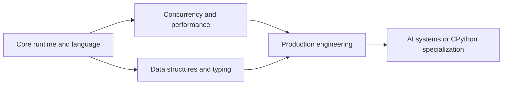

# Advanced Python Mastery - Study Plan

Use this as the progress tracker for our tutoring. Check a chapter only when you have completed the five checks beneath it. Do not aim to memorize every detail: aim to reason about behavior, build it, test failures, and explain trade-offs.

## How we will work

- **Pace:** 8-12 focused hours per week. The full program is approximately 20 weeks, but mastery matters more than speed.
- **Lesson format:** concept explanation and diagram -> small examples -> guided exercise -> hard problem -> review of your solution.
- **Completion rule:** a chapter is done only when you can explain it without notes, build the assigned artifact, test edge cases, complete the hard challenge, and review your mistakes.
- **Repository:** keep one `advanced-python-lab/` repository. Give each chapter a directory, tests, a short `NOTES.md`, and at least one intentionally broken example that you can diagnose.

## Phase 1 - Core runtime and language (Weeks 1-6)

### [ ] 01. Execution model and internals
**Outcome:** Explain source -> bytecode -> interpreter -> frame execution; inspect `dis` output and code objects.

- [ ] Explain LEGB, a call frame, a return, and traceback propagation.
- [ ] Build: a bytecode explorer using `dis` and `inspect`.
- [ ] Test: write examples for closure capture, global lookup, and exception propagation.
- [ ] Hard challenge: implement a tiny stack-machine interpreter for arithmetic instructions and document how it differs from CPython.
- [ ] Teach-back: explain why a `.pyc` cache is not a native executable.

### [ ] 02. Objects, identity, references, and mutability
**Outcome:** Predict aliasing, copying, hashing, reference lifetime, cyclic GC, and weak-reference behavior.

- [ ] Build: an object-graph visualizer using `id()`, `gc`, and `weakref`.
- [ ] Test: shallow/deep copies containing nested lists, tuples, and custom objects.
- [ ] Hard challenge: design a weak-reference cache that does not keep its values alive; prove it with tests and `gc.collect()`.
- [ ] Teach-back: explain `is`, `==`, hashability, and why mutable keys are unsafe.

### [ ] 03. Scope, namespaces, and binding
**Outcome:** Reliably reason about local, enclosing, global, and built-in name lookup.

- [ ] Build: closure-based counters and configurable callback factories.
- [ ] Test: late binding in loops, mutable defaults, shadowed built-ins, `global`, and `nonlocal`.
- [ ] Hard challenge: write a safe event-handler factory that creates 100 independent handlers without late-binding bugs.
- [ ] Teach-back: trace the lookup path for every name in a nested function.

### [ ] 04. Function design and advanced signatures
**Outcome:** Design clear APIs using positional-only, keyword-only, variadic parameters, `partial`, and introspection.

- [ ] Build: a configurable function pipeline library.
- [ ] Test: invalid call shapes and meaningful `TypeError` messages.
- [ ] Hard challenge: write a decorator that validates calls against a function signature while preserving metadata with `functools.wraps`.
- [ ] Teach-back: justify every parameter kind in one API you design.

### [ ] 05. Functional programming and closures
**Outcome:** Use composition, pure transformations, memoization, and closures without sacrificing clarity.

- [ ] Build: an immutable-style data-transformation pipeline.
- [ ] Test: cache correctness and cache invalidation assumptions.
- [ ] Hard challenge: implement bounded LRU memoization with a correct eviction policy, then compare it with `functools.lru_cache`.
- [ ] Teach-back: explain when a normal loop is better than `map`, `filter`, or `reduce`.

### [ ] 06. Decorators, wrappers, and instrumentation
**Outcome:** Build safe decorators for sync and async functions.

- [ ] Build: logging, retry, timing, caching, and validation decorators.
- [ ] Test: stacking order, exceptions, metadata, async functions, and concurrent calls.
- [ ] Hard challenge: create a rate-limit decorator that is thread-safe and supports both sync and async functions.
- [ ] Teach-back: predict the order in which three stacked decorators run.

### [ ] 07. Iteration, generators, and lazy pipelines
**Outcome:** Create iterators and streaming pipelines that use bounded memory.

- [ ] Build: a log-file pipeline that reads, filters, batches, and aggregates without loading the whole file.
- [ ] Test: generator cleanup, exhaustion, `send`, `throw`, and `close`.
- [ ] Hard challenge: implement a lazy `windowed(iterable, size)` utility that works for one-shot generators.
- [ ] Teach-back: distinguish iterable, iterator, generator function, and generator object.

### [ ] 08. Context managers and resource lifecycles
**Outcome:** Guarantee cleanup during normal execution, exceptions, and cancellation.

- [ ] Build: a transaction-style context manager and a temporary-resource manager.
- [ ] Test: cleanup when setup fails, body fails, and cleanup itself fails.
- [ ] Hard challenge: use `ExitStack` to acquire a variable number of resources atomically and roll back partial acquisition.
- [ ] Teach-back: explain why `finally` and context managers solve related but different problems.

### [ ] 09. OOP, composition, and inheritance
**Outcome:** Design extensible object boundaries without inheritance abuse.

- [ ] Build: a notification system with interchangeable delivery strategies.
- [ ] Test: multiple inheritance, MRO, cooperative `super()`, and abstract base classes.
- [ ] Hard challenge: refactor an inheritance-heavy design into composition and explain the trade-off.
- [ ] Teach-back: draw the MRO for a diamond inheritance example.

### [ ] 10. Data model and magic methods
**Outcome:** Make custom objects behave naturally in Python syntax and collections.

- [ ] Build: an immutable `Money` or `Vector` value object with ordering, arithmetic, formatting, and hashing.
- [ ] Test: equality/hash consistency, reflected operators, truthiness, and dictionary/set usage.
- [ ] Hard challenge: implement a small read-only sequence type with slicing and iteration.
- [ ] Teach-back: explain why defining `__eq__` changes the rules for `__hash__`.

### [ ] 11. Descriptors, properties, and metaclasses
**Outcome:** Understand the machinery behind properties, methods, validation, and framework fields.

- [ ] Build: reusable type/range validation descriptors.
- [ ] Test: data versus non-data descriptor precedence and inheritance behavior.
- [ ] Hard challenge: create a minimal declarative model system that collects field descriptors at class creation.
- [ ] Teach-back: choose between a property, descriptor, class decorator, `__init_subclass__`, and metaclass for five examples.

### [ ] 12. Typing, generics, and static analysis
**Outcome:** Use typing to improve API safety without fighting Python's dynamic strengths.

- [ ] Build: a typed generic repository and typed callback/decorator API.
- [ ] Test: mypy or Pyright errors for variance, narrowing, overloads, and protocols.
- [ ] Hard challenge: type a decorator that preserves arbitrary parameters and return type with `ParamSpec`.
- [ ] Teach-back: distinguish `Any`, `object`, `Protocol`, `TypeVar`, and `TypedDict`.

### [ ] 13. Exceptions and robust error design
**Outcome:** Model expected failures and preserve useful debugging context.

- [ ] Build: a small domain library with a custom exception hierarchy.
- [ ] Test: exception chaining, cleanup, `ExceptionGroup`, and secret-redaction behavior.
- [ ] Hard challenge: implement parallel validation that reports all independent failures using `ExceptionGroup`.
- [ ] Teach-back: classify failures as programmer bugs, expected domain errors, transient errors, or permanent external errors.

### [ ] 14. Collections, algorithms, and complexity
**Outcome:** Select structures based on measured access/update behavior.

- [ ] Build: priority scheduler, LRU cache, and streaming frequency counter.
- [ ] Test: collision/equality behavior, complexity assumptions, and ordering guarantees.
- [ ] Hard challenge: solve a sliding-window median or top-K streaming problem using standard-library structures.
- [ ] Teach-back: state time and space complexity for each implementation choice.

## Phase 2 - Performance and concurrency (Weeks 7-10)

### [ ] 15. Memory, performance, and profiling
**Outcome:** Measure before optimizing and find CPU or memory bottlenecks.

- [ ] Build: a reproducible benchmark harness using `timeit`, `cProfile`, and `tracemalloc`.
- [ ] Hard challenge: optimize a deliberately slow CSV/data-processing program by at least 5x, with before/after evidence.
- [ ] Teach-back: explain why a microbenchmark can be misleading.

### [ ] 16. Concurrency foundations and threading
**Outcome:** Build safe I/O concurrency with explicit shared-state discipline.

- [ ] Build: bounded thread-pool web fetcher with queues and graceful shutdown.
- [ ] Hard challenge: reproduce a race condition, make it deterministic in a test, then fix it without over-locking.
- [ ] Teach-back: explain the GIL without claiming it makes code thread-safe.

### [ ] 17. Multiprocessing and parallel work
**Outcome:** Use processes when CPU work justifies serialization and startup costs.

- [ ] Build: parallel image or numeric workload using `ProcessPoolExecutor`.
- [ ] Hard challenge: compare threads, processes, and vectorization on one CPU-bound task; report data-transfer overhead.
- [ ] Teach-back: explain why `spawn` changes how code must be structured.

### [ ] 18. Asyncio and structured concurrency
**Outcome:** Build cancellable, bounded async I/O systems.

- [ ] Build: async HTTP client with `TaskGroup`, timeouts, retries, semaphore limits, and streaming results.
- [ ] Hard challenge: implement a crawler with cancellation propagation and prove no task leaks after a failure.
- [ ] Teach-back: compare `gather` and `TaskGroup`; explain why blocking calls are dangerous in async code.

## Phase 3 - Production engineering (Weeks 11-16)

### [ ] 19. Packaging, imports, and environments
**Outcome:** Publish/install a reproducible package using `pyproject.toml`.

- [ ] Build: turn a previous lab into an installable CLI package with tests and pinned dependencies.
- [ ] Hard challenge: diagnose and fix a circular import without using lazy-import hacks.

### [ ] 20. Testing and engineering quality
**Outcome:** Write dependable tests for synchronous, async, and failure-prone code.

- [ ] Build: mature pytest suite with fixtures, parametrization, fakes, integration tests, and Hypothesis.
- [ ] Hard challenge: use property-based testing to find a real bug in one of your earlier data structures.

### [ ] 21. Debugging, logging, and observability
**Outcome:** Diagnose production failures from safe, useful telemetry.

- [ ] Build: structured logging, request IDs, metrics, and trace-friendly error reporting.
- [ ] Hard challenge: debug a supplied failing scenario using only logs, metrics, and a traceback.

### [ ] 22. Files, serialization, and data pipelines
**Outcome:** Process large, imperfect data safely and with bounded memory.

- [ ] Build: resumable streaming CSV/JSON ingestion pipeline with validation and atomic output.
- [ ] Hard challenge: process a multi-gigabyte-like generated file under a strict memory budget.

### [ ] 23. Networking and HTTP engineering
**Outcome:** Build network clients that behave correctly during slowdowns and failures.

- [ ] Build: resilient HTTP client with pooling, per-stage timeouts, retry policy, jitter, and idempotency keys.
- [ ] Hard challenge: build a local fault-injection server and demonstrate correct behavior for timeout, 429, 500, and malformed response cases.

### [ ] 24. Database and ORM engineering
**Outcome:** Design correct transactions and efficient queries.

- [ ] Build: database-backed service using migrations and SQLAlchemy.
- [ ] Hard challenge: find and eliminate an N+1 query; reproduce a transaction/deadlock issue and implement safe retry behavior.

### [ ] 25. Architecture and design patterns
**Outcome:** Separate business logic from frameworks and infrastructure.

- [ ] Build: refactor the database service into clean/hexagonal boundaries.
- [ ] Hard challenge: implement a plugin architecture with dependency inversion and a stable plugin contract.

### [ ] 26. Backend engineering with FastAPI
**Outcome:** Deployable API with validation, auth, lifecycle management, and streaming.

- [ ] Build: FastAPI service with Pydantic models, pagination, health checks, auth, and tests.
- [ ] Hard challenge: add WebSocket or SSE streaming while preserving graceful shutdown and backpressure.

### [ ] 27. Configuration, CLI, and operational readiness
**Outcome:** Make services configurable and safe to operate.

- [ ] Build: twelve-factor settings, validated environment configuration, typed CLI, and readiness checks.
- [ ] Hard challenge: write a failure-mode runbook and verify it by simulating missing secrets, broken dependencies, and shutdown signals.

### [ ] 28. Distributed systems and resilience
**Outcome:** Design for duplicated, delayed, or failed work.

- [ ] Build: idempotent background worker with durable job state and retry policies.
- [ ] Hard challenge: implement an outbox pattern and demonstrate recovery after a simulated crash between database commit and message publish.

### [ ] 29. Security for Python applications
**Outcome:** Recognize and prevent common application and supply-chain vulnerabilities.

- [ ] Build: security review checklist and hardened API endpoint.
- [ ] Hard challenge: secure an intentionally vulnerable mini-app against SQL injection, command injection, SSRF, unsafe deserialization, and leaked secrets.

## Phase 4 - Specialization (Weeks 17-20)

### [ ] 30. AI/ML and data engineering
**Outcome:** Build reproducible, resource-aware model/data pipelines.

- [ ] Build: versioned feature pipeline plus batch inference service with monitoring.
- [ ] Hard challenge: profile and fix a NumPy/Pandas pipeline suffering from copies, row loops, and dtype issues.

### [ ] 31. LLM, agents, and AI infrastructure
**Outcome:** Build reliable LLM workflows rather than fragile demos.

- [ ] Build: asynchronous tool-using workflow with structured outputs, tracing, retries, evaluation, and cost/latency tracking.
- [ ] Hard challenge: design an agent workflow that handles tool failure, prompt injection, cancellation, checkpoint/resume, and human approval.

### [ ] 32. CPython, AST, and native extensions
**Outcome:** Know when Python internals or native acceleration are justified.

- [ ] Build: AST-based code analyzer or transformation tool.
- [ ] Hard challenge: accelerate one measured bottleneck with Cython, Numba, or PyO3; benchmark it against clean Python and explain whether the complexity was worth it.

## Milestone projects

- [ ] **After Level 8:** Generator-based data pipeline with decorators and context-managed resources.
- [ ] **After Level 14:** Typed, tested in-memory task scheduler with custom data structures.
- [ ] **After Level 18:** Concurrent/async HTTP data collector with profiling report.
- [ ] **After Level 24:** Packaged database-backed service with migrations and integration tests.
- [ ] **After Level 29:** Production-style FastAPI service with observability, worker queue, security review, and runbook.
- [ ] **After Level 32:** Choose one capstone: AI workflow platform, high-performance data pipeline, or extensible developer tool.

## Weekly review

- [ ] I can explain this week's concepts without notes.
- [ ] I completed the build and all tests pass.
- [ ] I completed or made a serious attempt at the hard problem.
- [ ] I recorded mistakes, surprises, and unanswered questions in `NOTES.md`.
- [ ] I can name one trade-off for each major design choice.
